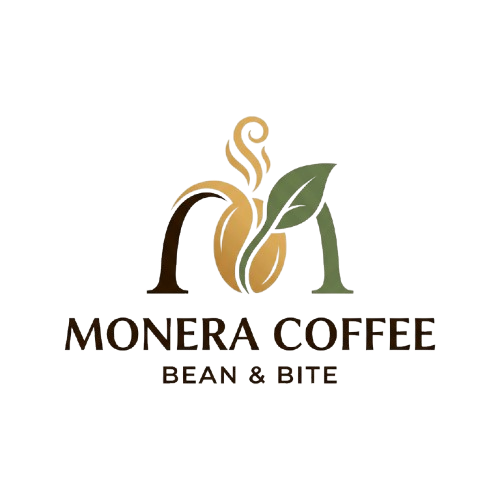

<p align="center">
  
</p>

<h1 align="center">Bean & Bite V.1.0.0</h1>

<p align="center">
  <strong>Sistem Informasi Manajemen Kafe Terpadu: Point of Sale (POS), Kitchen Display System (KDS), Pengendalian Stok Resep & Super Admin Hub</strong><br>
  <em>Monera Coffee — "Brewing Passion, Serving Warmth"</em><br>
  Smart Management for Coffee, Kitchen &amp; Beyond
</p>

<p align="center">
  <a href="#-spesifikasi-teknologi-rinci-tech-stack"></a>
  <a href="#-spesifikasi-teknologi-rinci-tech-stack"></a>
  <a href="#-spesifikasi-teknologi-rinci-tech-stack"></a>
  <a href="#-spesifikasi-teknologi-rinci-tech-stack"></a>
  <a href="#-spesifikasi-teknologi-rinci-tech-stack"></a>
  <a href="#-spesifikasi-teknologi-rinci-tech-stack"></a>
  <a href="#-spesifikasi-teknologi-rinci-tech-stack"></a>
  <a href="#-spesifikasi-teknologi-rinci-tech-stack"></a>
  <a href="CHANGELOG.md"></a>
  <a href="#-lisensi--riwayat-pembaruan"></a>
</p>

---

## 📑 Daftar Isi

- [☕ Tentang Monera Coffee & Bean & Bite](#-tentang-monera-coffee--bean--bite)
- [🔄 Alur Operasional Kafe Terpadu](#-alur-operasional-kafe-terpadu)
- [✨ Fitur-Fitur Utama](#-fitur-fitur-utama)
- [🛠️ Spesifikasi Teknologi Rinci (Tech Stack)](#️-spesifikasi-teknologi-rinci-tech-stack)
- [👥 Matriks Hak Akses Peran Pengguna](#-matriks-hak-akses-peran-pengguna)
- [🛡️ Arsitektur Keamanan & Integritas Data](#️-arsitektur-keamanan--integritas-data)
- [🧪 Verifikasi Kualitas Kode & Kompilasi Produksi](#-verifikasi-kualitas-kode--kompilasi-produksi)
- [📄 Lisensi & Riwayat Pembaruan](#-lisensi--riwayat-pembaruan)

---

## ☕ Tentang Monera Coffee & Bean & Bite

**Bean & Bite** adalah sistem informasi manajemen kafe modern berbasis web yang dikembangkan secara khusus untuk mengoperasikan **Monera Coffee** (*"Brewing Passion, Serving Warmth"*). Platform ini menyatukan seluruh rantai operasional harian bisnis *Food & Beverage* (F&B)—mulai dari titik penjualan di meja kasir (*Point of Sale*), layar antrean produksi minuman dan makanan (*Bar & Kitchen Display System*), pengendalian stok bahan baku otomatis berbasis formula resep, hingga pusat kendali analitik finansial (*HPP & Gross Margin*) serta jejak audit keamanan bagi pemilik usaha.

Dengan digitalisasi menyeluruh, **Bean & Bite** menjawab tantangan klasik operasional kafe seperti kesalahan pembacaan varian pesanan pada nota kertas, penumpukan antrean kasir di jam sibuk, kebocoran stok bahan baku, serta minimnya transparansi laporan kas shift harian.

---

## 🔄 Alur Operasional Kafe Terpadu

Seluruh siklus layanan di Monera Coffee berjalan terhubung secara langsung dalam satu ekosistem waktu nyata:

```text
  [1. Pelanggan] Memilih Menu, Varian Rasa & Menentukan Dine-In / Take Away
         │
         ▼
  [2. Admin / Kasir (POS)] Buka Shift (Nama Kasir + Kas Awal) ──► Input Order & Voucher Diskon
         │
         ├──► Pay First (Tunai / QRIS / Debit) ──► Cetak Struk Thermal (58mm/80mm)
         └──► Open Bill (Tagihan Gantung Meja)  ──► Pelunasan Saat Tamu Selesai
         │
         ▼ (Auto Potong Stok Gudang Sesuai Resep + Kirim Tiket Real-Time)
  [3. Barista & Koki (KDS 4 Stasiun Instan)]
         ├──► Stasiun Barista (Minuman) : Racik ──► Siap Saji (+ Opsi Undo)
         ├──► Stasiun Koki (Makanan)    : Masak ──► Siap Saji (+ Opsi Undo)
         └──► Kelola Menu Sold Out      : Toggle Inline + Proteksi Stok Gudang Habis
         │
         ▼ (Notifikasi Audio Chime ke Kasir & Rekonsiliasi Tutup Shift Z-Report)
  [4. Pemilik (Super Admin Hub)] Pantau Omzet, Laba Kotor HPP, Stok Kritis & Audit Logs
```

---

## ✨ Fitur-Fitur Utama

### 1. 💳 Terminal Kasir (*Point of Sale*) & Manajemen Shift
- **Kontrol Buka & Tutup Shift Kasir:** Pencatatan wajib nama kasir yang bertugas dan modal kas awal sebelum transaksi dimulai, serta rekonsiliasi uang fisik laci dengan catatan sistem (*Z-Report*) saat shift berakhir.
- **Katalog Interaktif & Kustomisasi Varian:** Pencarian menu cepat, filter kategori instan (*Coffee, Non-Coffee, Food, Pastry*), pemilihan varian rasa (*Ice/Hot, Sugar Level, Extra Shot*), serta catatan khusus pelanggan.
- **Transaksi Fleksibel (*Pay First* & *Open Bill*):** Mendukung pembayaran langsung di awal (Tunai dengan hitung kembalian instan, QRIS, Kartu Debit) maupun tagihan gantung meja (*Open Bill*) untuk tamu *dine-in*.
- **Voucher Promo & Pajak PB1 Otomatis:** Penerapan kupon diskon tersinkronisasi dari Super Admin beserta kalkulasi otomatis Pajak Restoran PB1 (10%).
- **Cetak Struk Thermal (58mm / 80mm):** Format cetak struk rapi yang memuat identitas kafe, nomor pesanan, nama kasir jaga, rincian diskon, pajak PB1, dan pesan footer kustom.
- **Pembatalan Berotorisasi (*Void*):** Mengharuskan alasan pembatalan tertulis, otomatis mengembalikan stok bahan baku ke gudang, dan tercatat pada log audit.

### 2. 🧑‍🍳 Layar Produksi Bar & Dapur (*Kitchen Display System*)
- **Navigasi 4 Stasiun Kerja Instan (*Zero Loading*):** Perpindahan cepat tanpa jeda muat ulang antara **Semua Antrean**, **Stasiun Barista (Kopi & Minuman)**, **Stasiun Koki (Makanan & Pastry)**, dan **Kelola Menu Sold Out**.
- **Antrean FIFO & Indikator Timer SLA:** Pengurutan tiket otomatis dari yang terlama dengan penanda batas waktu warna (*Normal, Peringatan, Terlambat*).
- **Batch Summary & Siklus Aksi Cepat:** Rekapitulasi total item racikan secara kolektif di bagian atas layar beserta tombol progres cepat (*Mulai Racik $\rightarrow$ Siap Saji*) dan fitur **Undo** untuk mengoreksi kesalahan klik.
- **Panel Kelola Menu Sold Out Inline:** Mengubah status ketersediaan menu secara langsung dari layar dapur tanpa modal *popup*, dilengkapi 4 kartu KPI stok dan penguncian otomatis apabila bahan baku resep di gudang habis.
- **Notifikasi Suara (*Audio Chime*):** Memberikan peringatan suara bel saat tiket pesanan masuk ke dapur maupun saat pesanan siap diambil di kasir, disertai tombol kontrol audio di *header*.

### 3. 👑 Pusat Kendali Pemilik (*Super Admin Hub*)
- **8 Modul Terpadu:** Ringkasan bisnis *real-time*, manajemen pengguna, katalog menu & resep, inventaris gudang, mutasi stok, laporan keuangan, pengaturan kafe & voucher, serta *audit logs*.
- **Manajemen Akun Staf (*Super Admin Control*):** Pembuatan akun staf, perubahan peran, reset kata sandi, penonaktifan sementara (*suspend*), serta pemutusan sesi aktif paksa (*force logout*).
- **Kalkulasi HPP & Estimasi Laba Kotor:** Perhitungan otomatis Harga Pokok Produksi (HPP) berdasarkan takaran resep bahan baku untuk memantau margin keuntungan aktual kafe.
- **Manajemen Voucher Diskon & Pengaturan Kafe:** Pembuatan kupon promo persentase maupun nominal dengan syarat belanja minimal dalam tabel berpaginasi (maksimal 5 data per halaman), serta konfigurasi nama toko, footer struk, dan tarif PB1.
- **Jejak Audit Komprehensif (*Audit Logs*):** Pencatatan transparan seluruh aksi sensitif lengkap dengan aktor, waktu, alamat IP, *user agent*, dan perubahan data sebelum/sesudah.

---

## 🛠️ Spesifikasi Teknologi Rinci (*Tech Stack*)

| Lapisan Sistem | Teknologi | Versi / Spesifikasi | Peran dalam Sistem |
| :--- | :--- | :--- | :--- |
| **Backend Framework** | **Laravel** | `13.x` (`PHP 8.4`) | Pengendali logika bisnis, *RBAC Middleware*, validasi input, dan transaksi basis data atomik. |
| **Frontend Library** | **React & TypeScript** | `React 19.2` • `TS 5.7` | Antarmuka pengguna interaktif (*Single Page Application*) dengan pengetikan statis ketat. |
| **Fullstack Bridge** | **Inertia.js & Wayfinder** | `Inertia 3.0` | Penghubung SPA modern antara Laravel controller dan komponen React tanpa API terpisah. |
| **UI Styling & Icons** | **Tailwind CSS & Lucide** | `Tailwind v4.1` | Sistem desain kustom palet Monera Coffee (*Espresso, Crema, Matcha, Berry*) yang responsif. |
| **Database Engine** | **MySQL** | `MySQL 8.0` (3NF) | Penyimpanan relasional terstruktur untuk transaksi, shift, stok, resep, promo, dan audit log. |
| **Asset Bundler** | **Vite-Plus (`vp`)** | `v1.4.0` | Kompilasi aset CSS/JS teroptimasi untuk pengembangan cepat dan *production build*. |
| **Interactive Alerts** | **SweetAlert2** | `v11.26` | Dialog konfirmasi modern dan notifikasi *toast* responsif untuk aksi kritikal kasir/admin. |

---

## 👥 Matriks Hak Akses Peran Pengguna

| Modul & Fungsionalitas | Pelanggan | Admin / Kasir | Barista / Koki | Pemilik *(Super Admin)* |
| :--- | :---: | :---: | :---: | :---: |
| **Melihat Menu, Memesan, Pakai Voucher & Bayar** | ✅ | ✅ *(Input POS)* | ❌ | ❌ *(Monitor)* |
| **Manajemen Profil Mandiri & Ganti Password** | ❌ | ✅ | ✅ | ✅ |
| **Buka / Tutup Shift Kasir & Cetak Z-Report** | ❌ | ✅ | ❌ | ✅ *(Force Close)* |
| **Transaksi POS (*Pay First*, *Open Bill*, Struk Thermal)** | ❌ | ✅ | ❌ | ❌ *(Monitor)* |
| **Pembatalan Pesanan (*Void* Wajib Alasan)** | ❌ | ✅ *(Shift Aktif)* | ❌ | ✅ *(Override)* |
| **Layar Produksi KDS 4 Stasiun & Aksi *Racik/Siap/Undo*** | ❌ | ❌ *(Serah Terima)* | ✅ | ✅ *(Live Monitor)* |
| **Kontrol Ketersediaan Menu (*Sold Out Inline*)** | ❌ | ✅ *(Lihat)* | ✅ | ✅ |
| **Manajemen Akun Staf (*CRUD, Reset, Suspend, Force Logout*)** | ❌ | ❌ | ❌ | ✅ |
| **Master Menu, Resep HPP & Inventaris Bahan Baku** | ❌ | ✅ *(Restock)* | ❌ *(Lihat)* | ✅ *(Penuh)* |
| **Manajemen Voucher Diskon, Pengaturan Toko & Pajak PB1** | ❌ | ❌ *(Terapkan)* | ❌ | ✅ |
| **Dashboard Omzet, Estimasi Laba HPP & *Audit Logs*** | ❌ | ❌ | ❌ | ✅ |

---

## 🛡️ Arsitektur Keamanan & Integritas Data

1. **Pengendalian Akses Berlapis (*RBAC & Active Guard*):** Setiap rute dilindungi oleh *middleware* pemeriksaan sesi, verifikasi status keaktifan pengguna (`EnsureUserIsActive`), dan pembatasan hak akses peran (`EnsureRole`).
2. **Proteksi Input & Header Keamanan:** Menerapkan *middleware* sanitasi input (`SanitizeInput`), perlindungan CSRF pada seluruh form Inertia, *parameterized query* Eloquent ORM untuk mencegah SQL Injection, serta penambahan *Security Headers*.
3. **Integritas Transaksi Atomik (ACID):** Penyimpanan pesanan, rincian item, pembayaran, pemotongan saldo bahan baku gudang per resep, dan pencatatan mutasi dijalankan di dalam *Database Transaction* guna mencegah data korup atau pengurangan stok ganda.
4. **Snapshot Histori Finansial:** Setiap transaksi menyimpan salinan nilai harga jual, harga pokok (HPP), diskon promo, dan persentase pajak saat transaksi terjadi agar laporan historis tetap akurat meskipun harga master diubah di kemudian hari.
5. **Perlindungan Repositori Ketat:** Berkas konfigurasi environment (`.env`), kunci kriptografi, konfigurasi backend, skema migrasi internal, pengujian, serta dokumentasi internal terlindungi penuh oleh konfigurasi `.gitignore`.

---

## 🧪 Verifikasi Kualitas Kode & Kompilasi Produksi

Kualitas kode sumber diverifikasi secara berkala melalui pemeriksaan tipe statis, validasi sintaks PHP, standardisasi kode PSR-12, serta kompilasi bundel aset produksi:

```bash
# 1. Verifikasi pengetikan statis TypeScript / JSX
npm run types:check

# 2. Kompilasi aset frontend produksi (Vite-Plus)
npm run build

# 3. Pemeriksaan sintaks PHP & standardisasi gaya kode
php -l app/Http/Controllers/Owner/DashboardController.php
```

---

## 📄 Lisensi & Riwayat Pembaruan

- **Lisensi Perangkat Lunak:** Dilisensikan di bawah ketentuan *MIT License*.
- **Catatan Perubahan Versi:** Seluruh riwayat pembaruan fitur, penyempurnaan antarmuka, dan perbaikan *bug* terdokumentasi lengkap pada berkas [**`CHANGELOG.md`**](CHANGELOG.md).

---

<p align="center">
  <strong>Monera Coffee — Powered by Bean &amp; Bite</strong><br>
  <em>"Smart Management for Coffee, Kitchen &amp; Beyond"</em><br>
  © 2026 Bean &amp; Bite. All rights reserved.
</p>
